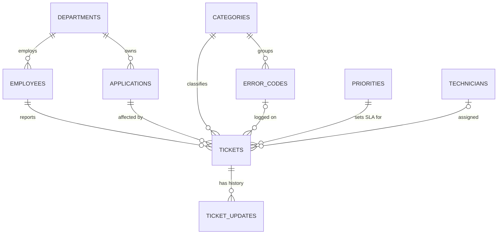

# IT Support Ticket Management & SLA Monitoring

A PostgreSQL database that tracks IT incidents across a company's business
applications and monitors them against Service Level Agreements (SLAs).
It's built to show the SQL and troubleshooting skills used in
**Application Support** roles.

**Tech:** PostgreSQL 18 · SQL · psql · VS Code · Git / GitHub

## Business scenario

Employees report problems with the HR Portal, Payroll System, Inventory
Manager, CRM and other internal applications: login failures, database
errors, crashes and slow performance. The IT support team needs to know:

- Which tickets are unresolved, and which are already **overdue**?
- Are we meeting our **SLA** response and resolution targets?
- Which **errors keep recurring**, and in which applications?
- Is the **workload** spread fairly across technicians?

## SLA policy

| Priority | First response within | Resolution within |
|----------|-----------------------|-------------------|
| Critical | 30 minutes | 4 hours |
| High     | 1 hour     | 8 hours |
| Medium   | 4 hours    | 24 hours |
| Low      | 8 hours    | 72 hours |

An open ticket is **At Risk** once 75% of its resolution time is used, and
**Breached** once its deadline passes.

## Database design

Nine normalized tables (3NF). The full diagram is in [docs/er_diagram.md](docs/er_diagram.md).



Business rules are enforced with constraints. For example, a ticket cannot
be resolved before it was created, and a "Closed" ticket must have a close time.

## Project structure

```
sql/
  00_build_all.sql            one command builds everything
  01_schema.sql               tables, keys, CHECK constraints
  02_seed_data.sql            reproducible synthetic data (~50,000 tickets)
  03_views.sql                SLA status, overdue list, technician workload
  04_analysis.sql             10 business questions answered in SQL
  05_troubleshooting.sql      7 incident investigations
  06_indexes_performance.sql  EXPLAIN ANALYZE before/after indexing
  07_transactions.sql         safe updates: COMMIT, ROLLBACK, SAVEPOINT, SKIP LOCKED
  99_checks.sql               automated data-quality assertions
docs/
  er_diagram.md               ER diagram + design decisions
  performance.md              index benchmark results
```

## How to run

Requires PostgreSQL 14+ (tested on 18).

```bash
# 1. create an empty database
psql -U postgres -c "CREATE DATABASE it_support;"

# 2. build schema, data, views and indexes, then run the checks
psql -U postgres -d it_support -f sql/00_build_all.sql

# 3. explore
psql -U postgres -d it_support -f sql/04_analysis.sql
psql -U postgres -d it_support -f sql/05_troubleshooting.sql
psql -U postgres -d it_support -f sql/07_transactions.sql   # changes data; re-run step 2 to reset
```

The build takes about 5 seconds and ends with `NOTICE: All checks passed`.
Every object lives in the `support` schema, so rebuilding never touches
anything else in the database.

**Reproducible data:** `setseed()` makes the generator produce identical data
on every run, and SLA status is measured at a fixed reporting time
(`support.report_time()` = 2026-10-01 09:00). Everyone gets the same results.

## SQL techniques demonstrated

| Technique | Where |
|-----------|-------|
| INNER / LEFT / self JOINs | views, `04` Q4/Q10, `05` Case 3 |
| CTEs (`WITH`), including data-modifying CTEs | `04` Q2/Q3/Q5, `07` Demo 1 |
| Subqueries (scalar, in `FROM`, `HAVING`, `NOT EXISTS`) | `04` Q6/Q10, `05` Case 6 |
| Window functions: `LAG`, `RANK`, `ROW_NUMBER`, running `SUM`, `AVG OVER` | `04` Q3/Q4/Q5/Q9, `05` Cases 1/4 |
| Aggregates with `FILTER`, `percentile_cont` | `04` Q1/Q7 |
| Views | `03_views.sql` |
| B-tree, composite and partial indexes, `EXPLAIN ANALYZE` | `06` |
| Transactions, `SAVEPOINT`, `FOR UPDATE SKIP LOCKED` | `07` |
| `pg_stat_activity`, `pg_blocking_pids` (live DB troubleshooting) | `05` Case 7 |

## Key findings

| Finding | Evidence | Recommended action |
|---------|----------|--------------------|
| Overall resolution SLA met for ~76% of tickets | `04` Q1 | Target 90%. Start with the items below |
| **Payroll System** has the highest breach rate (26%) | `04` Q6 | Review Payroll database error handling |
| **Payroll deadlock burst:** 120 `DB-1205` tickets on 15 Sep, 08:30–12:30 | `05` Case 1 | Problem record for the DBA team |
| One technician meets SLA on 64.8% of tickets vs. ~77% for peers | `04` Q4 | Coaching / workload review |
| 25 open tickets still assigned to a technician who **left the company** | `05` Case 2 | Reassigned in `07` Demo 1 |
| 405 open tickets are older than 30 days, mostly stuck "On Hold" | `04` Q8, `05` Case 4 | Weekly On Hold review |
| ~40 duplicate tickets (same user and issue within 30 minutes) | `05` Case 3 | Merge duplicates; add duplicate warning to the portal |
| Missing foreign-key index made ticket-history lookups ~120x slower | `docs/performance.md` | Index added |

*The data is synthetic. The incidents above were planted deliberately, so
the investigation scripts have realistic problems to find.*
