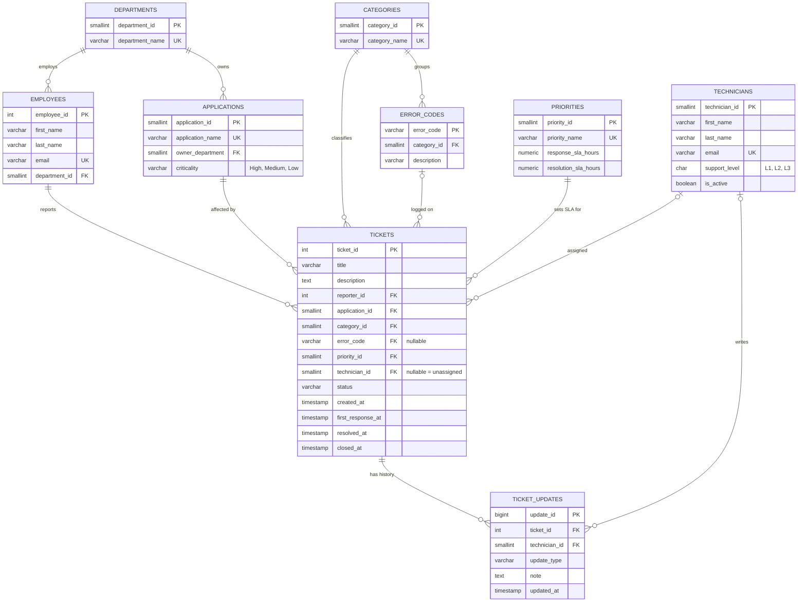

# Entity-Relationship Diagram

GitHub renders the diagram below automatically.
`||--o{` reads as "one ... to zero-or-many".

## Design decisions

- **3rd normal form.** Names of departments, applications, categories and
  priorities are stored once and referenced by ID, so renaming one is a
  single-row update.
- **SLA targets live on `priorities`**, not on each ticket. Changing the
  policy for "High" changes it everywhere.
- **Employees and technicians are separate tables.** They play different
  roles (reporting vs. resolving) and have different attributes.
- **`ticket_updates` is an append-only audit trail**, so an investigation can
  rebuild exactly what happened to a ticket and when.
- **CHECK constraints enforce business rules** in the database itself:
  a ticket cannot be resolved before it was created, and a "Closed" ticket
  must have a `closed_at` time.
